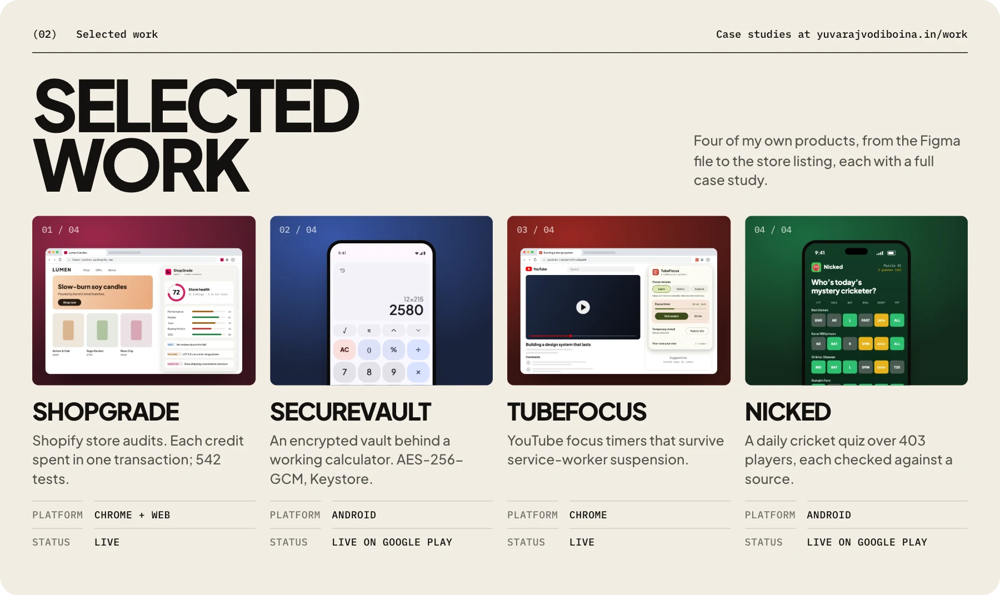

# Yuvaraj Vodiboina

**Independent Software Engineer at CodeHorizon** · Web, Chrome extensions and Android

  <a href="https://yuvarajvodiboina.in/"><b>Portfolio</b></a>&nbsp;&nbsp;·&nbsp;&nbsp;<a href="https://yuvarajvodiboina.in/Yuvaraj_Resume.pdf"><b>Résumé&nbsp;(PDF)</b></a>&nbsp;&nbsp;·&nbsp;&nbsp;<a href="https://www.linkedin.com/in/yuvarajvodiboina/">LinkedIn</a>&nbsp;&nbsp;·&nbsp;&nbsp;<a href="mailto:yvodiboina@gmail.com">Email</a>&nbsp;&nbsp;·&nbsp;&nbsp;<a href="https://codehorizon.in/">CodeHorizon</a>

I'm a software engineer in Hyderabad who builds web apps, Chrome extensions and native Android apps end to end, in React, Next.js, TypeScript, Kotlin and Jetpack Compose. Most recently I was a Frontend Engineer at Truedune Beauty, and I work independently through [CodeHorizon](https://codehorizon.in/). I've built eleven products: six Chrome extensions and five Android apps. Eight are live on the Chrome Web Store or Google Play, Compass is in testing, and two are retired. **Open to roles on-site in Hyderabad or remote.**

<a href="https://yuvarajvodiboina.in/#work">
<picture>
  <source media="(max-width: 767px)" srcset="https://raw.githubusercontent.com/yuvarajvodiboina/yuvarajvodiboina/main/assets/v13/work-mobile.webp">
  
</picture>
</a>

**Case studies:** [ShopGrade](https://yuvarajvodiboina.in/work/shopgrade/) · [SecureVault](https://yuvarajvodiboina.in/work/securevault/) · [TubeFocus](https://yuvarajvodiboina.in/work/tubefocus/) · [Nicked](https://yuvarajvodiboina.in/work/nicked/) · [Keeptake](https://yuvarajvodiboina.in/work/keeptake/) · [Compass](https://yuvarajvodiboina.in/work/compass/) · [CSS Class Highlighter](https://yuvarajvodiboina.in/work/cssclass/) · [engineering notes](https://github.com/yuvarajvodiboina/engineering-case-studies)

**Writing:** [Insights](https://codehorizon.in/insights/), sourced and animated explainers on this year's Android, Chrome, Shopify and Search changes.

**Code and case studies**

CodeHorizon's product repositories are private. The case studies cover architecture, testing and release decisions. My public work includes contributions to Wikimedia Commons Android and Android device projects.

**Experience**
- **Independent Software Engineer, CodeHorizon** · Oct 2024 to now. Eleven products designed and built, eight live, with payments, ads and store releases. I handle engineering, testing, support and releases.
- **Frontend Engineer, Truedune Beauty** · Bengaluru, Oct 2025 to Aug 2026. React, Next.js and TypeScript storefront, a reworked single-click checkout and six A/B tests.
- **Web Developer, Kalpa Corporate Artz** · contract, 2025. Earlier, frontend internships at Intern Stump and MSsquare Technologies.

**Education:** B.Tech in Computer Science and Engineering, JNTU-GV (2024) · Google UX Design and Docker Foundations certificates · a published paper on UI/UX and user trust. 
## Open source

### Wikimedia Commons Android

Four maintainer-merged pull requests since October 2026, with regression coverage using Kotlin, Robolectric and Mockito.

- [#7252](https://github.com/commons-app/apps-android-commons/pull/7252) preserves photo edits and fixes a location picker crash when Android recreates the upload screen.
- [#7071](https://github.com/commons-app/apps-android-commons/pull/7071) moves upload progress to a silent notification channel while keeping completion alerts.
- [#7184](https://github.com/commons-app/apps-android-commons/pull/7184) splits the achievements screen into the screen and two tested helpers.
- [#7069](https://github.com/commons-app/apps-android-commons/pull/7069) skips unsupported shared files before copying, avoiding a 12.6 MB copy per RAW photo in testing.

[Contribution case study](https://yuvarajvodiboina.in/work/wikimedia-commons/)

### Android community projects

[AxionAOSP](https://github.com/yuvarajvodiboina/axion-pipa), an Android 15 build for the Xiaomi Pad 6, plus device trees for the [Pad 6](https://github.com/yuvarajvodiboina/android_device_xiaomi_pipa) and [POCO X2](https://github.com/yuvarajvodiboina/device_xiaomi_phoenix), and [TWRP](https://github.com/yuvarajvodiboina/twrp_device_xiaomi_phoenix). My idea of a quiet weekend is fixing a boot loop.

