  
  
  
  

  <a href="#01--selected-work">SELECTED WORK</a> &nbsp; / &nbsp;
  <a href="#02--open-source-in-production">OPEN SOURCE</a> &nbsp; / &nbsp;
  <a href="#03--tools-i-build-with">TECH STACK</a> &nbsp; / &nbsp;
  <a href="#04--github-activity">GITHUB ACTIVITY</a>

I take software from **interface design to production releases**. At [CodeHorizon](https://codehorizon.in/), I've built six Chrome extensions and five Android apps. Previously, I built React, Next.js and Shopify storefronts at **Truedune Beauty**. I also contribute to **Wikimedia Commons Android**.

## 01 / Selected work

A few things I've designed, engineered and released. Open a case study for the architecture, tradeoffs and release history.

<table>
  <tr>
    <td width="50%" valign="top">
      

      
01 · CHROME EXTENSION + WEB · LIVE

      <h3><a href="https://yuvarajvodiboina.in/work/shopgrade/">ShopGrade ↗</a></h3>
      
<strong>Shopify audits, with evidence behind every finding.</strong>

      
One transaction spends a credit and grants the report entitlements, protecting against crashes and concurrent requests.

      
React · TypeScript · Appwrite

      
<a href="https://yuvarajvodiboina.in/work/shopgrade/"><strong>Explore the case study →</strong></a>

    </td>
    <td width="50%" valign="top">
      

      
02 · NATIVE ANDROID · LIVE

      <h3><a href="https://yuvarajvodiboina.in/work/securevault/">SecureVault ↗</a></h3>
      
<strong>An encrypted file vault behind a working calculator.</strong>

      
AES-256-GCM encryption, biometric unlock and keys held in Android Keystore.

      
Kotlin · Jetpack Compose · Android Keystore

      
<a href="https://yuvarajvodiboina.in/work/securevault/"><strong>Explore the case study →</strong></a>

    </td>
  </tr>
  <tr>
    <td width="50%" valign="top">
      

      
03 · CHROME EXTENSION · LIVE

      <h3><a href="https://yuvarajvodiboina.in/work/tubefocus/">TubeFocus ↗</a></h3>
      
<strong>YouTube focus sessions that survive browser lifecycle changes.</strong>

      
Timers survive service-worker suspension. Serialized settings writes keep state consistent.

      
Manifest V3 · Chrome APIs · JavaScript

      
<a href="https://yuvarajvodiboina.in/work/tubefocus/"><strong>Explore the case study →</strong></a>

    </td>
    <td width="50%" valign="top">
      

      
04 · CHROME EXTENSION · LIVE

      <h3><a href="https://yuvarajvodiboina.in/work/keeptake/">Keeptake ↗</a></h3>
      
<strong>Screen, webcam and audio recording, with local recovery.</strong>

      
Recording chunks persist locally for crash recovery, with webcam compositing and MP4 export.

      
MediaRecorder · IndexedDB · OffscreenCanvas

      
<a href="https://yuvarajvodiboina.in/work/keeptake/"><strong>Explore the case study →</strong></a>

    </td>
  </tr>
</table>

**Also shipped:** [Nicked](https://yuvarajvodiboina.in/work/nicked/), a daily cricket puzzle with 403 verified players, a stable daily schedule and serialized DataStore saves. [Companion AI](https://yuvarajvodiboina.in/work/companion/), [Speaker Cleaner](https://yuvarajvodiboina.in/work/speaker/) and [CSS Class Highlighter](https://yuvarajvodiboina.in/work/cssclass/) are live too. [Compass](https://yuvarajvodiboina.in/work/compass/) is in Google Play testing.

[**All 11 products and their release history →**](https://codehorizon.in/products/) &nbsp; · &nbsp; [**Public engineering case studies →**](https://github.com/yuvarajvodiboina/engineering-case-studies)

## 02 / Open source, in production

### Wikimedia Commons Android · 4 merged contributions

Four maintainer-merged pull requests, with regression tests using **Kotlin, Robolectric and Mockito**.

| Pull request | Contribution |
| --- | --- |
| [#7252](https://github.com/commons-app/apps-android-commons/pull/7252) | Preserved photo edits and fixed a location picker crash when Android recreates the upload screen. |
| [#7071](https://github.com/commons-app/apps-android-commons/pull/7071) | Moved upload progress to a silent notification channel while preserving completion alerts. |
| [#7184](https://github.com/commons-app/apps-android-commons/pull/7184) | Split the achievements screen into the screen and two tested helpers. |
| [#7069](https://github.com/commons-app/apps-android-commons/pull/7069) | Skipped unsupported shared files before copying, avoiding a 12.6 MB RAW-file copy in testing. |

[Read the contribution case study →](https://yuvarajvodiboina.in/work/wikimedia-commons/)

### Android community work

I published an unofficial **[AxionAOSP Android 15 build for Xiaomi Pad 6](https://github.com/yuvarajvodiboina/axion-pipa)** and worked on device trees for [Pad 6](https://github.com/yuvarajvodiboina/android_device_xiaomi_pipa), [POCO X2](https://github.com/yuvarajvodiboina/device_xiaomi_phoenix) and [TWRP](https://github.com/yuvarajvodiboina/twrp_device_xiaomi_phoenix).

## 03 / Tools I build with

  <picture>
    <source media="(prefers-color-scheme: light)" srcset="https://skillicons.dev/icons?i=ts,js,react,nextjs,tailwind,nodejs,html,css,kotlin,androidstudio,java,firebase,appwrite,python,flask,postgres,docker,git,githubactions,figma&amp;perline=10&amp;theme=light">
    
  </picture>

- **Web and extensions** — React, Next.js, TypeScript, Node.js, Manifest V3, Chrome APIs and Shopify Liquid.
- **Android** — Kotlin, Jetpack Compose, Coroutines, Room, DataStore, WorkManager, Hilt and Android Keystore.
- **Backend and quality** — Appwrite, Firebase, Python, Flask, SQL, Cloudflare, Jest, Playwright, GitHub Actions and Figma.

## 04 / GitHub activity

  <a href="https://github.com/yuvarajvodiboina?tab=overview">
    <picture>
      <source media="(prefers-color-scheme: light)" srcset="https://streak-stats.demolab.com/?user=yuvarajvodiboina&amp;theme=default&amp;hide_border=true&amp;ring=0284C7&amp;fire=7C3AED&amp;currStreakLabel=0284C7&amp;disable_animations=true">
      
    </picture>
  </a>

Live contribution totals and streaks from my GitHub profile.

<strong>Experience and background</strong>

| Role | Work |
| --- | --- |
| **Independent Software Engineer · CodeHorizon** Oct 2024–present | Product design, development, testing, store releases and maintenance across Chrome and Android. |
| **Frontend Engineer · Truedune Beauty** Oct 2025–Aug 2026 | React, Next.js and TypeScript storefronts, Shopify Liquid, checkout improvements, six A/B tests and React Native contributions. |
| **Web Developer · Kalpa Corporate Artz** Sep–Nov 2025 · Contract | Figma to a production Next.js website, with GitHub Actions and Cloudflare Pages. |
| **Frontend Engineer Intern · Intern Stump** May–Oct 2024 | Accessible React and TypeScript components, Jest tests and frontend performance work. |
| **Web Development Intern · MSsquare Technologies** Apr–Sep 2023 | HTML, CSS, JavaScript, Bootstrap, page speed and technical SEO. |

B.Tech in Computer Science and Engineering, Avanthi Institute of Engineering & Technology, JNTU-GV (2024). Google UX Design and Docker Foundations certifications.

<strong>Explore the code and writing</strong>

CodeHorizon product repositories are private. I document their architecture, testing and release decisions in [engineering case studies](https://github.com/yuvarajvodiboina/engineering-case-studies) and [my portfolio](https://yuvarajvodiboina.in/). I also write technical explainers at [CodeHorizon Insights](https://codehorizon.in/insights/).

Earlier public projects include a [Flask and Socket.IO chat app](https://github.com/yuvarajvodiboina/Chat_Room) and [IdentiFlash, an Android flashlight app in Java](https://github.com/yuvarajvodiboina/identi_flash).

---

<h2 align="center">Let's build the next thing.</h2>

  I'm interested in <strong>frontend and software engineering roles</strong> in Hyderabad or remote. 
  React · Next.js · TypeScript · Chrome extensions · Native Android

  
  

